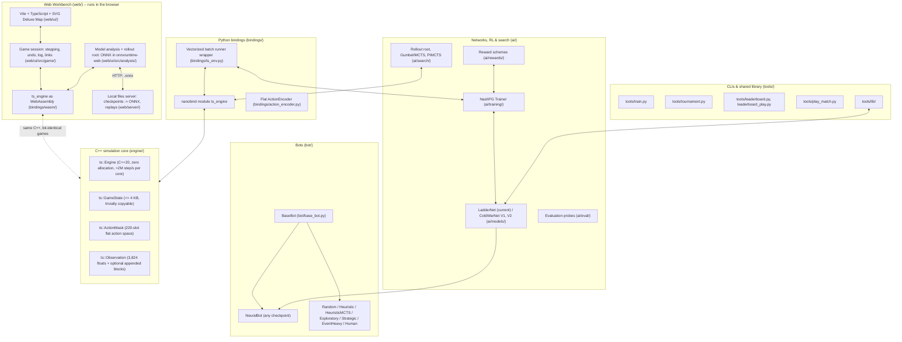
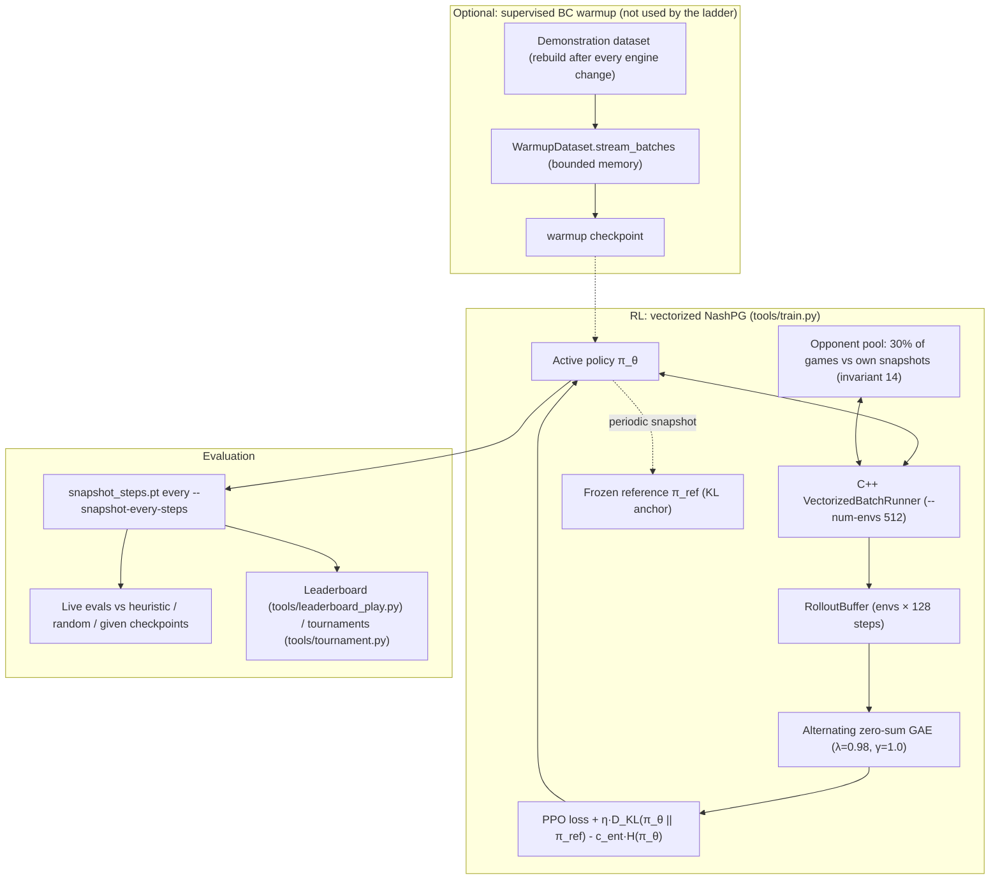

# Twilight Struggle AI: Project Guide & Agent Instructions

This repository contains the AI, simulation engine, web workbench, and training infrastructure for
the Deluxe Edition of **Twilight Struggle** (110 cards).

`CLAUDE.md` is the short, canonical version of the build, test and launch commands and of every
rule; this file adds the architecture, the directory map and the full text of the invariants.
Per-directory guides: [`engine/AGENTS.md`](engine/AGENTS.md), [`bindings/AGENTS.md`](bindings/AGENTS.md),
[`bot/AGENTS.md`](bot/AGENTS.md), [`web/server/AGENTS.md`](web/server/AGENTS.md),
[`web/ui/AGENTS.md`](web/ui/AGENTS.md); the CLIs are documented in [`tools/README.md`](tools/README.md)
and the research record in [`research/README.md`](research/README.md).

---

## 1. Project Architecture & Components



---

## 2. Directory Structure

```
.
├── CMakeLists.txt              # Root CMake: orchestrates engine/ and bindings/; clang only
├── pyrefly.toml / pytest.ini   # Static typing and test configuration
├── BUGS.md                     # Open and recently fixed defects (ENG-*, TEST-*, CONV-*, BIND-*)
│
├── engine/                     # C++20 simulation engine (engine/AGENTS.md)
│   ├── include/ts/             # Headers: GameState, MicroAction, ActionMask, CachedState, ...
│   ├── src/                    # Rules: state machine, ops, scoring, space race, events/{early,mid,late}_war.cpp
│   └── tests/                  # ts_tests, ts_fuzz, ts_fuzz_events, ts_benchmark
│
├── bindings/                   # nanobind bridge + Python env wrappers (bindings/AGENTS.md)
│   ├── ts_bindings.cpp         # module: ts_engine, VectorizedBatchRunner, BatchedSearch, RolloutBatch
│   ├── batched_search.hpp      # C++ MCTS tree for ai/search/batched_mcts.py
│   ├── rollout_batch.{hpp,cpp} # the rollout root's worlds and playouts, shared with the WebAssembly build
│   ├── playout_labels.{hpp,cpp} # P34's labeller: positions played to the game's end in N worlds, outcomes captured
│   ├── gomp_parallel.hpp       # gomp_parallel_for: the one OpenMP pool, shared with torch
│   ├── state_json.{hpp,cpp}    # display state + save as JSON, shared with the WebAssembly build
│   ├── selftest.hpp            # whole-game digest compiled into both builds (parity check)
│   ├── wasm/ts_engine_wasm.cpp # the engine's C API for the browser (Emscripten, build_web.sh)
│   ├── ts_engine/              # GENERATED stub package; overrides in ts_engine.pyi.pattern
│   ├── action_encoder.py       # flat action <-> MicroAction codec
│   ├── settle.py               # SettleMode: the one rule for advancing past uncontrolled nodes
│   └── ts_env.py               # single and vectorized environments for RL
│
├── ai/
│   ├── models/                 # ladder_net.py (LadderNet, --arch ladder: the current lineage);
│   │                           # coldwar_net_v2.py (V2 + ColdWarNetMLP), coldwar_net.py (V1),
│   │                           # kept so older checkpoints load; grow.py (in-place widening)
│   ├── training/               # train.py (CLI behind tools/train.py), nash_pg.py, rollout_buffer.py,
│   │                           # opponent_pool.py, behavioral_cloning.py, warmup_dataset_loader.py,
│   │                           # human_corpus_dataset.py, search_workers.py, start_pool.py, ...
│   ├── rewards/                # reward_calculator.py: perspective-aligned zero-sum reward schemes
│   ├── search/                 # rollout_root.py, gumbel_root.py, batched_mcts.py, dmcts.py,
│   │                           # pimcts.py, heuristic_mcts.py
│   └── eval/                   # probe suite: calibration, ablations, behaviour, human-corpus agreement, ...
│
├── bot/                        # BaseBot and baselines (bot/AGENTS.md)
│
├── web/
│   ├── ui/                     # the browser workbench and the leaderboard page (web/ui/AGENTS.md)
│   ├── server/                 # local files server + replay writer (web/server/AGENTS.md)
│   └── stats_worker/           # Cloudflare Worker + D1: games people played against the models
├── deploy/web/                 # Dockerfile (+ compose, README) deploying the workbench from GitHub
│
├── tools/                      # CLIs (tools/README.md)
│   ├── train.py, tournament.py, play_match.py         # the three unified CLIs (invariant 9)
│   ├── leaderboard.py, leaderboard_play.py           # Elo leaderboard: register, play, fit, show
│   ├── publish_hf.py, export_onnx.py                 # Hugging Face publishing; ONNX export
│   ├── generate_dataset.py, build_human_dataset.py   # demonstration datasets
│   ├── download_ts_replayer.py, fetch_acts_corpus.py # human game corpora
│   ├── inspect_checkpoints.py, behavioral_test.py, annotate_replay.py, ...
│   ├── lib/                    # shared backend: ts_replayer_{parse,convert,hands}.py (corpus conversion),
│   │                           # self_play.py (the replay writer), player_agent.py / player_spec.py,
│   │                           # tournament_evaluator.py, batch_tournament.py, parallel_tournament.py,
│   │                           # leaderboard.py, action_view.py, data_root.py, corpus_paths.py,
│   │                           # engine_fingerprint.py (sources -> stale build), engine_behaviour.py
│   │                           # (what the engine does -> leaderboard epoch), checkpoint_utils.py, ...
│   └── scripts/                # check_engine_fresh.sh, launch_flags.py, run_codes.py, watch_run.py,
│                               # build_web.sh, install_emsdk.sh, install_clang_userspace.sh,
│                               # run_asan.sh, check_doc_links.py, cloud/ (remote GPU runs), probes
│
├── tests/                      # pytest, split by what is under test (CLAUDE.md "Tests")
│   ├── conftest.py             # --run-fuzz; ignores tests/differential at collection;
│   │                           # generated_replay_dir, corpus and converted_game fixtures
│   ├── bindings/  engine_logic/  replayer/  training/  web/  docs/  lint/
│   └── differential/           # cross-engine fuzzing vs external/struggler -- WIP, not run (BUGS.md TEST-1)
│
├── leaderboard/                # Elo records: networks.json, players.json, epochs.json, matches/<epoch>.jsonl
│                               # (append-only); ratings are fitted at page build, never committed
├── research/                   # the research record (research/README.md)
├── docs/                       # standalone notes (behavioural test claims, struggler comparison, ...)
├── rules/                      # formal spec the engine implements; Rules_Final.pdf is git-ignored
├── external/struggler/         # reference engine (git submodule) for differential testing
├── data/                       # [GIT IGNORED] checkpoints, replays, datasets, corpora
└── build/, build_san/          # [GIT IGNORED] release and sanitizer builds
```

---

## 3. Workflows

### 3.1 Build, test, type-check

The commands are in `CLAUDE.md` ("Build & environment setup", "Tests & type checking"). For a CUDA
build of PyTorch, install `torch` from pytorch.org first; the rest of `requirements.txt` installs on
top of it.

`tools/scripts/check_engine_fresh.sh` (invariant 13) hashes the `engine/` and `bindings/` sources
and compares them with the stamp written beside the built module: exit 0 when they match, rebuild
and exit **1** when not, so a chained command stops. It hashes content rather than comparing mtimes
because a branch checkout rewrites mtimes without changing anything.

### 3.2 Training



How to launch: `CLAUDE.md` ("Running training ..."): derive the flags from a healthy run with
`tools/scripts/launch_flags.py`, never from a template (invariant 15). Two A/B rules: every budget
is in env steps (there is no wall-clock flag, since steps/sec depends on the policy), and both arms
must share `--train-steps` **and** `--pool-every-steps`, which sets how fast the opponent pool grows.
`--snapshot-every-steps` is reporting only: evaluation restores the RNG streams it draws from.
Training pools reject members whose observation feature bits differ from the learner's, including
equal-width feature sets and newly added league members.
Every `training_metrics.jsonl` metric is mirrored to `<run-dir>/tb` for TensorBoard
(`.venv/bin/python -m tensorboard.main --logdir <run-dir>/tb`; `--no-tensorboard` to skip).
How to run and rate an arm, and how to record it: `research/method/running_experiments.md`,
`research/method/bookkeeping.md`.

### 3.3 The web workbench

`tools/scripts/build_web.sh`, then `PYTHONPATH=.:build/release .venv/bin/python -m web.server.main
--port 8000` and open `http://localhost:8000/`. Everything runs in the page: watching replays (with
the model's policy and critic per step when traced), playing either side to test the engine (forced
dice, debug overrides, undo, export), analysing positions with a model (local checkpoint exported
to ONNX, a Hugging Face repo, or a dropped `.onnx`; policy argmax or the rollout root), and playing
one side against the model with the other side's private information hidden. The address bar is
the share link. Details: [`web/ui/AGENTS.md`](web/ui/AGENTS.md). Deployment: GitHub Pages with no
server (`.github/workflows/pages.yml`), or `deploy/web/Dockerfile` (`deploy/web/README.md`).

A finished game can be submitted to the **stats database** with the player's Playdek login and
rating: the page sends the game's compact record (seed, steps, who made each move and under which
settings, the build's commit) to a Cloudflare Worker that keeps it in D1
([`web/stats_worker/README.md`](web/stats_worker/README.md)). The page is the only writer; nothing
is hosted here. `tools/game_stats.py` exports the table, re-drives each game in the engine, and
fits each model player's rating on Playdek's scale from the clean games
([`tools/README.md`](tools/README.md) §2d).
The rating command verifies each record in the current engine before including it, reporting
failed verification and other-engine exclusions. Browser rollout search always owns its engine;
model replacement terminates the old worker and settles its initialization and search requests.

### 3.4 CLIs

The three unified CLIs are `tools/train.py`, `tools/tournament.py` (two models: a head-to-head with
loss causes; more or a directory: a round robin with Bradley-Terry Elo) and `tools/play_match.py`
(any two agents, `--us human` for terminal play, `.tslog.json` replays). The human corpus is
downloaded by `tools/download_ts_replayer.py` and converted, verified entry by entry against the
log's own boards, by `tools/lib/ts_replayer_*.py`; every game converts in full. Everything else,
with flags: [`tools/README.md`](tools/README.md).
Human conversion requires successful whole-game hand solving with z3; it reports failure before
emitting decisions when solving is unavailable. The terminal heuristic reads influence from
name-keyed display countries; tournament `HeuristicAgent` is a separate implementation.

Save loaders reject a supplied context depth outside the six-entry decision stack before
publishing a state. Keyed chance packs player values as unsigned bytes so USSR (-1) cannot erase
turn, round, decision or roll-target fields; keyed-search measurements and labels from before
this correction need to be retaken.

---

## 4. Key Maintenance Invariants for Agents

Numbered as in `CLAUDE.md`.

1. **Zero heap allocations in the engine core.** `ts::GameState` stays trivially copyable
   (`std::is_trivially_copyable_v<GameState>`) and within 4 KB, so states copy as bytes in search
   and batches.
2. **One flat action space.** Every policy head and mask uses the flat space of
   `bindings.ActionEncoder` / `ActionMask::generate_flat_mask_212` (220 slots since P17; the name is
   historical). The E4.1 merged-influence view (P23) is not a second encoding: same slots, composed
   actions *defined* as the E4 steps they name. A checkpoint's view is read from its run directory
   (`tools/lib/action_view.py`), and every harness builds masks in the deciding agent's view.
3. **NashPG reference regularization.** The active policy is regularized against a frozen snapshot
   π_ref with fixed η; the reference update is never coupled to the active policy's gradient step,
   which is what keeps the dynamics from cycling.
4. **Deterministic PRNG.** All simulation randomness uses `state.rng_state` with SplitMix64
   (`ts::Prng`), so any game replays bit for bit from its seed.
5. **Strict type annotations.** All Python is annotated (`TypedDict`s in
   `web/server/replay_types.py` for every serialized structure), and after any Python change
   `.venv/bin/pyrefly check ai tools tests web bindings` returns 0 errors — with explicit paths,
   since a bare run can match zero files and pass.
6. **One replay writer.** All self-play and `.tslog.json` recording goes through
   `tools.lib.self_play.generate_self_play_replay`, so every replay follows `ReplayLogDict`. A step
   may carry a **trace** (`policy` before the move, `critic` after it; `ai/eval/policy_readout.py`,
   `web/server/AGENTS.md`). Two rules hold for any writer: **recording a belief must not change
   what is played** (`read_policy` consumes the torch RNG exactly as `sample_action`;
   `tests/training/test_policy_readout.py`, `test_replay_trace.py`), and **every reader treats the
   trace blocks as optional**.
7. **Checkpoint directories are named from the run name.** `tools/train.py --run-name
   E<n>-A<n>-R<n>-S<n>[@<step>M+<changes>]` builds `<name>_<date>_<time>` and records the name in
   `metadata.json` (`research/method/run_nomenclature.md`; the A/R codes are
   `research/architectures_and_recipes.md`); `tools/scripts/run_codes.py --run <dir>` checks the
   name against the recorded flags. An unchanged continuation (`--resume` of the run's own
   directory under the same name) writes into that directory and records the leg under `legs`.
   Directories from before 2026-10-07 keep their old names (`research/run_name_map.md`). No step
   count in the name: one directory holds a lineage's every budget. `run_<arch>_<date>_<time>` is
   the fallback for smoke runs outside a lineage. Ad-hoc names are forbidden because they do not
   say which engine or seed produced the run.
8. **Bounded dataset streaming.** Demonstration data is read with `WarmupDataset.stream_batches` /
   `stream_transitions`, never loaded whole into memory, which would exhaust RAM on
   multi-million-transition sets.
9. **No ad-hoc scripts.** Never write one-off code to run behavioural cloning, training,
   tournaments or matches: training (BC warmup or RL) is `tools/train.py`, evaluation is
   `tools/tournament.py` (or the leaderboard CLIs), matches and replays are `tools/play_match.py`.
10. **Commit and record before training.** Commit the code locally first (never push), and pass
    `tools/train.py --description "..."`, which writes the commit hash, mode and description into
    the run's `metadata.json`, so every run can be traced to its code.
11. **Never change the C++ engine (`engine/`) without the owner's prior approval**, without
    exception: an engine change moves the decision stream under every checkpoint and dataset.
12. **Human replay conversion is never approximated.** The corpus trains a model of how people
    play, so a decision the log does not determine is never invented, defaulted or filled by a
    heuristic: it is a failure to diagnose. The same holds for the engine: report a "safety net"
    fallback instead of relying on it, and fail loudly. The two approved, narrow exceptions are the
    cards Our Man in Tehran looks at, and the individually diagnosed log errors in `_KNOWN_SCORE` /
    `_LOG_MISCOUNTED` / `_INVALID_PLAYS` (`tools/lib/ts_replayer_convert.py`). Cite the exact
    replay, turn and action round for a mismatch, and propose engine fixes rather than making them.
13. **Never measure against a stale engine.** Every artifact — checkpoint, dataset, Elo anchor,
    diagnostic, converted replay — is relative to the engine that produced it. Run
    `tools/scripts/check_engine_fresh.sh` first, and treat anything measured before a rebuild as a
    different game until re-taken. Both failure modes are silent: `(seed, actions)` datasets
    truncate each game at its first newly-illegal action (biasing what remains toward openings),
    and old checkpoints keep loading and running.
14. **An RL run needs an opponent pool** (`--opponent-frac 0.3 --opponent-self-pool
    --opponent-pool-size 12`): without it one seat runs away and the critic loses all skill, as
    happened twice (`research/archive/E3_ladder/log/P15_X4b_collapse_is_pool_starvation.md`,
    `research/log/E4_pool_starvation_recurrence.md`).
15. **Derive a launch command from a healthy run** with `tools/scripts/launch_flags.py <reference>
    --diff <yours>`, before and after launching; four lineage-critical flags drifted when copied
    from templates (`research/findings/training/e4_architecture_discontinuity.md`).

Also the owner's: **never change the observation without asking** (`CLAUDE.md` "Architecture",
`engine/AGENTS.md` §6a).

### Test data that is not in the repository

The replay and checkpoint trees under `data/` are git-ignored, so **no test may assume either holds
anything**, and none may skip when its input is missing: a skipping check passes everywhere while
verifying nothing, this repository's most repeated bug. Use the `generated_replay_dir` fixture
(`tests/conftest.py`): it writes a replay with `generate_self_play_replay` (an untrained network if
no checkpoint) into a temp dir and points the server at it through `TS_REPLAYS_DIR`, in about a
second. Schema changes are caught by `tests/bindings/replay_schema.golden.json`, regenerated
deliberately with `PYTHONPATH=.:build/release .venv/bin/python tests/bindings/test_replay_schema_golden.py`.
For workbench replays during development, generate them:
`PYTHONPATH=. .venv/bin/python tools/play_match.py --us heuristic --ussr strategic --game-id scratch`.

---

## 5. Run Test Suites

Which groups to run for which change, the commands, the human corpus the replayer tests need, and
the pyrefly and differential-suite rules are in `CLAUDE.md` ("Tests & type checking"). In short:
pick the groups by what you touched; never run the whole of `tests/web` for AI or tools changes;
a missing corpus fails rather than skips; `tests/differential/` is not run. The `converted_game`
session fixture (`tests/conftest.py`) memoizes `convert_game` by replay id for tests that want it.

---

## 6. Keep Documentation Synchronized

`engine/AGENTS.md`, `bindings/AGENTS.md`, `bot/AGENTS.md`, `web/server/AGENTS.md` and
`web/ui/AGENTS.md` each require their own file **and this one** to be updated when behaviour in
that directory changes; this file carries the same duty in reverse. A change to an interface, an
invariant, a CLI flag or a directory's contents is not finished until the documentation says so in
the same change. `README.md` and `CLAUDE.md` are published, so what they claim must be true of the
code as it stands, with experiment history and private artifacts left out.
